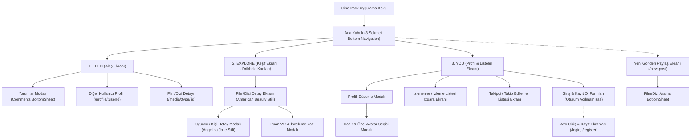

# 🎬 CineTrack Mobile — UI/UX Tasarım ve Ekran Mimarisi Şartnamesi
> **Hedef Kitle:** UI/UX Tasarımcıları (Figma / Sketch / Adobe XD) ve Ürün Geliştirme Ekipleri  
> **Platform:** iOS & Android (Flutter Cross-Platform)  
> **Tasarım Dili:** Modern Minimalist Sinema Deneyimi, Dribbble Movie Explorer & shadcn/ui Estetiği  
> **Sürüm:** 2.0 (Kapsamlı Ekran Mimarisi)

---

## 📌 1. Ürün Özeti ve Tasarım Vizyonu

### 1.1. Ürün Tanımı
**CineTrack**, sinema ve dizi tutkunlarının içerikleri keşfettiği, izleme geçmişlerini kaydettiği, puanlayıp incelediği ve toplulukla unutulmaz film repliklerini paylaştığı yeni nesil sosyal sinema platformudur (*Letterboxd + Instagram + Modern TMDB Keşif Deneyimi*).

### 1.2. Tasarım Prensipleri
1. **İçerik Odaklı Sinematik Zarafet:** Poster ve sanat görselleri arayüzün yıldızıdır. Saf beyaz (`#FFFFFF`) ve derin siyah (`#0D0E12`) arka planlar görsel kontrastı maksimuma çıkarır.
2. **Kusursuz Tipografi ve Hiyerarşi:** Güçlü, cesur başlıklar (`FontWeight.w800`) ve okunabilir, net alt metinler.
3. **Akıcı Kart ve Fade Geçişleri:** Görsellerin kartın zeminine yumuşak bir degrade ile erimesi (*fade-to-background*).
4. **shadcn/ui Bileşen Disiplini:** İnce zarif sınır çizgileri (`1px solid #F0F1F5`), 16–20px yuvarlak köşeler (`rounded-2xl`), temiz pill etiketler (`ShadBadge`) ve minimal buton stilleri.

---

## 🎨 2. Tasarım Sistemi Temelleri (Design Tokens)

### 2.1. Renk Paleti (Color Palette)

| Token İsmi | Hex Kodu (Aydınlık) | Hex Kodu (Karanlık) | Kullanım Alanı |
| :--- | :--- | :--- | :--- |
| **Primary (Amber Altını)** | `#F5A623` | `#F5A623` | Aksiyon butonları, yıldız puanlamaları, kupa ikonları, aktif göstergeler |
| **Primary Accent (Canlı Turuncu)**| `#FF9500` | `#FFA116` | Vurgu alanları, play butonları, gradient geçişleri |
| **Background (Zemin)** | `#FFFFFF` | `#0D0E12` | Ana sayfa ve ekran arka planı |
| **Card Surface (Kart Zemini)** | `#FFFFFF` | `#161820` | shadcn Kart, Sheet ve Modal arka planları |
| **Text Primary (Başlıklar)** | `#14171A` | `#FFFFFF` | Film başlıkları, kullanıcı isimleri, modal başlıkları |
| **Text Muted (İkincil Metin)** | `#8A90A0` | `#8E92A0` | Yıl, yönetmen, @kullanıcıadı, etiketler, tarihler |
| **Border / Divider** | `#F0F1F5` | `#232634` | Kart kenarlıkları, form sınırları, ayırıcı çizgiler |
| **Success (İzlendi/Beğeni)** | `#2ECC71` | `#2ECC71` | İzlendi durumları, başarı bildirimleri |
| **Destructive (Kırmızı)** | `#EF4444` | `#F87171` | Silme aksiyonları, hata durumları, beğenilen kalp ikonu |

### 2.2. Tipografi Ölçeği (Typography)

* **Font Ailesi:** SF Pro Display / Inter / Plus Jakarta Sans
* **Display / Hero Başlık:** `26px - 28px` / Bold (800) / Tracking -0.5
* **Ekran Başlığı (H1):** `20px - 22px` / Bold (800) / Tracking -0.3
* **Bölüm Başlığı (H2):** `16px - 18px` / SemiBold (700) / Tracking -0.2
* **Gövde Metni (Body):** `14px` / Regular (400) / Line Height 1.5
* **Küçük Bilgi / Altyazı:** `12px - 13px` / Medium (500)
* **Mikro Etiket (Badge/Date):** `10px - 11px` / SemiBold (600)

### 2.3. İkonografi ve Süslemeler
* **İkon Stili:** İnce çizgi kontur (Outline, 1.8px stroke width). Seçili durumlarda dolgulu (Filled).
* **Gölgeler:** Çok hafif, dağıtılmış yumuşak ambient gölge (`boxShadow: 0 4px 16px rgba(0,0,0,0.03)`).
* **Köşe Yuvarlama (Radius):**
  * Kartlar & Modallar: `16px` – `20px`
  * Butonlar & Giriş Alanları: `12px` – `14px`
  * Hap Etiketler (Pills/Badges): `18px` – `20px`

---

## 🗺️ 3. Bilgi Mimarisi ve Ekran Haritası



---

## 📱 4. Ekran Bazında Detaylı Şartname ve Bileşen Hiyerarşisi

---

### EKRAN 1: Explore (Keşif & Sinema Kartları)
> **Rota:** `/explore`  
> **Konsept:** Dribbble "Movie Explorer" tam sayfa kaydırılabilir kart slider'ı (The Martian, Little Miss Sunshine).

```
+-------------------------------------------------------+
|  [Trending] [Top Rated] [Now Playing] [Upcoming]  (🔍) |
+-------------------------------------------------------+
|                                                       |
|  +-------------------------------------------------+  |
|  | [               FILM POSTERİ                   ]|  |
|  | [         (Görselin yarısından itibaren         ]|  |
|  | [          beyaza yumuşak fade erimesi)         ]|  |
|  |                                                 |  |
|  |                   The Martian                   |  |
|  |               2015 · Ridley Scott               |  |
|  |                    ★ ★ ★ ★ ★                    |  |
|  |                                                 |  |
|  |                      ( ▶ )                      |  |
|  |                     More ⌄                      |  |
|  +-------------------------------------------------+  |
|                                                       |
+-------------------------------------------------------+
|  [🏠 Feed]              [🔍 Explore]         [👤 You] |
+-------------------------------------------------------+
```

#### Bileşen Listesi ve Düzeni
1. **Üst Kategori & Arama Barı:**
   * Yatay kayan filtre hapları: `Trending`, `Top Rated`, `Now Playing`, `Upcoming`. Seçili olan koyu siyah arka plan, seçilmemiş olanlar ince gri kenarlıklı beyaz hap.
   * Sağda büyüteç ikonu (`Icons.search_rounded`). Tıklandığında inline `ShadInput` arama alanına dönüşür.
2. **Büyük Film Kartı (MovieExplorerCard - PageView):**
   * **Üst Sanat Alanı (%60 Yükseklik):** 32px yuvarlatılmış köşeli büyük TMDB posteri. Alttan yukarıya doğru `transparent -> white.withOpacity(0.7) -> white` geçişli lineer degrade.
   * **Başlık & Meta Bilgi:** Ortalanmış büyük film başlığı (24px, w800). Altında `Yıl · Yönetmen` (ör: `2015 · Ridley Scott` veya TV dizisi ise `2016 · TV Series`).
   * **Puanlama Yıldızları:** 5 adet altın amber yıldız (★★★★★) (TMDB 10 puan üzerinden 5 yıldıza dinamik dönüştürülür).
   * **Amber Play / Aksiyon Butonu:** 52x52px yuvarlak, parlak amber gradyanlı (`#F5A623`), merkezinde beyaz play üçgeni. Hafif amber gölgeye sahiptir. Fragman oynatır veya detay sayfasına yönlendirir.
   * **More ⌄ Linki:** Butonun hemen altında detay sayfasına yönlendiren küçük zarif "More" metni ve aşağı ok ikonu.
3. **Ekran Durumları:**
   * *Loading:* Merkezde amber dönen indikatör.
   * *Swipe Hareketi:* Sağa/sola yumuşak sayfalama (`PageView.builder`, `viewportFraction: 0.92`).

---

### EKRAN 2: Media Detail (Film & Dizi Detay Ekranı)
> **Rota:** `/media/:type/:id`  
> **Konsept:** Dribbble "American Beauty" ekranı. Saf beyaz, derin tipografik hiyerarşi, dikey akıcı sinema bülteni.

```
+-------------------------------------------------------+
| (<)                 American Beauty                (♡)|
|                   1999 · Sam Mendes                   |
+-------------------------------------------------------+
| Cast                                                  |
| [ Foto ]    [ Foto ]    [ Foto ]    [ Foto ]          |
| K. Spacey   A. Bening   T. Birch    W. Bentley        |
| L. Burnham  C. Burnham  J. Burnham  R. Fitts          |
|                                                       |
| Awards                                                |
| 🏆 🏆 🏆 🏆 🏆  5 Oscars, 4 Golden Globes... 5 more    |
|                                                       |
| Genres                                                |
| Drama, Romance, Psychological                         |
|                                                       |
| Storyline                                             |
| After his death sometime in his forty-third year,     |
| suburbanite Lester Burnham tells of the last... More  |
|                                                       |
| Country                                               |
| United States                                         |
|                                                       |
| Budget                                                |
| $15,000,000 (estimated)                               |
|                                                       |
| Cumulative Worldwide Gross                            |
| $356,200,000                                          |
|                                                       |
| [ ★  Add a review                                   ] |
+-------------------------------------------------------+
```

#### Bileşen Listesi ve Düzeni
1. **Minimalist Üst Bar (App Bar):**
   * Sol: İnce chevron geri oku (`<`).
   * Orta: 2 satırlı ortalanmış başlık (Üst: Film Adı `17px, w800`, Alt: `1999 · Sam Mendes` gri `12px`).
   * Sağ: Watchlist / Favori kalp ikonu (`♡` boş kalp veya izleme listesindeyse kırmızı dolu kalp `♥`).
2. **Oyuncu Kadrosu (Cast - Yatay Liste):**
   * Başlık: "Cast" (`18px, w800`).
   * 90x90px kare, 12px yuvarlatılmış köşeli aktör vesikalığı.
   * Altında 1. satır aktör ismi (`w700`), 2. satır karakter adı (`gri, 11px`).
   * *Etkileşim:* Herhangi bir aktöre tıklandığında **Actor Detail Modal** (Angelina Jolie ekranı) açılır.
3. **Ödüller ve Başarılar (Awards):**
   * Başlık: "Awards".
   * 5 adet kupa emojisi/ikonu `🏆 🏆 🏆 🏆 🏆` ve yanında ödül özeti veya `8.4 Puan · 24K Yorum · En İyiler Sıralaması`.
4. **Türler (Genres):**
   * Başlık: "Genres".
   * Virgülle ayrılmış şık metin veya minimal shadcn badge formatı (`Drama, Love story, Psychological movie`).
5. **Özet (Storyline):**
   * Başlık: "Storyline".
   * Okunaklı paragraf metni. 4 satırdan uzunsa sonunda amber renkli **"More"** tıklanabilir genişleticisi yer alır.
6. **Finansal & Ülke Metrikleri (Key Metadata):**
   * `Country` (Yapım Ülkesi)
   * `Budget` (Bütçe: Örn. `$15,000,000`)
   * `Cumulative Worldwide Gross` (Küresel Gişe Geliri: Örn. `$356,200,000`)
7. **Puanlama ve İnceleme Aksiyon Butonu:**
   * Ekranın en altında tam genişlikte amber renkli **ShadButton**: `★ Add a review`.
   * Tıklandığında 5 yıldızlı puan seçici ve yorum yazma modali açılır.

---

### EKRAN 3: Actor / Person Detail (Oyuncu & Kişi Modalı)
> **Tetikleyici:** Detay sayfasındaki Cast kartına tıklandığında açılır.  
> **Konsept:** Dribbble "Angelina Jolie" ekranı.

```
+-------------------------------------------------------+
| (<)                 Angelina Jolie                 (♥)|
|                     Actress · 43yo                    |
+-------------------------------------------------------+
| [                                                   ] |
| [            BÜYÜK OYUNCU PORTRESİ                  ] |
| [         (Alttan yukarıya doğru beyaza             ] |
| [           pürüzsüz eriyen degrade fade)           ] |
| [                                                   ] |
|                                                       |
| Awards                                                |
| 🏆 🏆 🏆 🏆 🏆  1 Oscar, 3 Golden Globes... 12 more    |
|                                                       |
| About                                                 |
| Angelina Jolie is an American Academy Award-winning   |
| actress who became popular after playing the... More  |
|                                                       |
| Department                                            |
| Acting                                                |
|                                                       |
| Character Role                                        |
| Carolyn Burnham                                       |
|                                                       |
| Popularity Score                                      |
| 78.4 pts                                              |
+-------------------------------------------------------+
```

#### Bileşen Listesi ve Düzeni
1. **Modal Başlığı:** Sol geri/kapat butonu, merkezde oyuncu ismi ve unvanı (`Actress / Actor`), sağda favorileme kalp butonu.
2. **Hero Portre Alanı (340px Yükseklik):** Yüksek çözünürlüklü dikey oyuncu fotoğrafı. Fotoğrafın alt kısmı beyaz kart zeminine pürüzsüzce erir.
3. **Ödüller (Awards):** Kupa ikonları ve sanatçının aldığı ödül özetleri.
4. **Biyografi (About):** Oyuncunun kariyer özeti ve `More` genişletme butonu.
5. **Detay Parametreleri:** Departman (`Acting/Directing`), Oynadığı Karakter ve Popülerlik puanı.

---

### EKRAN 4: Feed (Topluluk & Aktivite Akışı)
> **Rota:** `/feed`  
> **Konsept:** Topluluk paylaşımları, film replikleri, kullanıcı incelemeleri ve sosyal etkileşimler.

```
+-------------------------------------------------------+
|  Feed                                     [TR]  (🌙)  |
+-------------------------------------------------------+
| +---------------------------------------------------+ |
| | [👤 Avatar]  Serhat Çakır  @serhatc       [REPLİK]| |
| |                                                   | |
| |  “Houston, we have a problem.”                    | |
| |  (Sol kenarı 3.5px amber şeritli alıntı kutusu)   | |
| |                                                   | |
| |  +---------------------------------------------+  | |
| |  | [Poster] Apollo 13                          |  | |
| |  |          Film · ★ 8.6 / 10                  |  | |
| |  +---------------------------------------------+  | |
| |  -----------------------------------------------  | |
| |  ♡ 142 Beğeni      💬 18 Yorum          ↗ Paylaş  | |
| +---------------------------------------------------+ |
|                                                       |
| +---------------------------------------------------+ |
| | [👤 Avatar]  Merve Demir  @merved         [YORUM] | |
| |              ★ ★ ★ ★ ★ (9.0/10)                   | |
| |  Film baştan sona nefes kesiciydi. Ridley Scott   | |
| |  yine ustalığını konuşturmuş...                   | |
| +---------------------------------------------------+ |
|                                                 (+)   |
+-------------------------------------------------------+
|  [🏠 Feed]              [🔍 Explore]         [👤 You] |
+-------------------------------------------------------+
```

#### Bileşen Listesi ve Düzeni
1. **Üst Bar:**
   * Sol: Büyük bold `Feed` logosu/başlığı.
   * Sağ: Dil değiştirici hap butonu (`TR / EN`) ve Gece/Gündüz tema değiştirici anahtar ikonu (`🌙 / ☀️`).
2. **Gönderi Kartı (ShadCard):**
   * **Yazar Başlığı:** Yuvarlak `ShadAvatar`, isim, `@kullanıcıadı`, sağda gönderi tipi rozeti (`ShadBadge`: Amber "Replik" veya Yeşil "Yorum"). Kendi gönderisi ise sağda 3 nokta düzenle/sil menüsü.
   * **Replik Bloğu (Quote Type):** İtalik font, tırnak işaretleri, sol tarafında 3.5px kalınlığında amber vurgu şeridi olan özel alıntı kutusu.
   * **İnceleme & Metin (Review Type):** Kullanıcı açıklaması ve verilmişse 10 üzerinden puan yıldızı rozeti.
   * **İlişkili Film Önizleme Kartı:** Gönderiyle ilişkili filmin 52x75px boyundaki posteri, adı, dizi/film etiketi ve varsa puanı. Tıklandığında film detayına gider.
   * **Sosyal Etkileşim Barı:**
     * Kalp Beğeni butonu (Beğenildiğinde kırmızıya döner ve sayaç anlık artar).
     * Yorum butonu (Yorum sayısını gösterir, tıklandığında **Comments Sheet** açılır).
3. **Yüzen Paylaşım Butonu (Floating Action Button):**
   * Sağ altta amber renkli yuvarlak buton (`+`). Tıklandığında `/new-post` ekranını açar.

---

### EKRAN 5: Comments Modal (Yorumlar Çekmecesi)
> **Tetikleyici:** Feed'deki veya detaydaki yorum butonuna basıldığında alttan açılır (`showModalBottomSheet`).

```
+-------------------------------------------------------+
|                      ─── [Bar] ───                    |
| Yorumlar (18)                                      (X)|
+-------------------------------------------------------+
| [👤]  Ali Yılmaz                                      |
|       Görsel efektler çağının çok ötesindeydi!        |
|       12 dk önce · ♡ 4                                |
|                                                       |
| [👤]  Canan Kaya                                      |
|       Müziklerine kesinlikle ayrı bir parantez        |
|       açmak gerek. Hans Zimmer harikası.              |
|       1 saat önce · ♡ 12                              |
+-------------------------------------------------------+
| [ Bir yorum yaz... (ShadInput)                 ] [ > ]|
+-------------------------------------------------------+
```

#### Bileşen Listesi
1. **Modal Başlığı:** Üstte gri tutamaç çizgisi, Yorum Sayısı başlığı ve kapat butonu.
2. **Yorum Listesi:** Kullanıcı avatarı, kullanıcı adı, yorum metni, beğeni kalp ikonu ve kendi yorumuysa silme opsiyonu.
3. **Alt Giriş Alanı:** Klavyenin üzerinde sabitlenen `ShadInput` metin kutusu ve amber Gönder butonu (`Icons.send_rounded`).

---

### EKRAN 6: You / Profile (Kullanıcı Profili & İstatistikler)
> **Rota:** Kendi profili için `/profile`, başka kullanıcı için `/profile/:userId`.  
> **Konsept:** Modern Letterboxd istatistik paneli, 4 tıklanabilir sayaç kartı ve kullanıcının film günlüğü.

```
+-------------------------------------------------------+
|  You (Profil)                                     (🚪)|
+-------------------------------------------------------+
|  [     👤     ]  Serhat Çakır                         |
|  [ ShadAvatar ]  @serhatc                             |
|  [   (80px)   ]  Sinema tutkunu, bilim kurgu aşığı.   |
|                                                       |
|  [ ✏️  Profili Düzenle (ShadButton.outline)          ] |
|                                                       |
|  +---------+   +---------+   +---------+   +---------+|
|  |   👥    |   |   ➕    |   |   🎬    |   |   📺    ||
|  |   124   |   |   85    |   |   342   |   |   48    ||
|  | Takipçi |   | Takip   |   | İzlenen |   | İzlenen ||
|  +---------+   +---------+   +---------+   +---------+|
|                                                       |
|  Bana Ait Akış (12)                                   |
|  +-------------------------------------------------+  |
|  | (Kullanıcının paylaştığı PostCard listesi)      |  |
|  +-------------------------------------------------+  |
+-------------------------------------------------------+
|  [🏠 Feed]              [🔍 Explore]         [👤 You] |
+-------------------------------------------------------+
```

#### Bileşen Listesi ve Düzeni
1. **Üst Bar:** Sayfa başlığı ve oturumu kapatma (`Icons.logout_rounded`) ikonu. Tıklandığında `ShadDialog.alert` onay penceresi açılır.
2. **Kullanıcı Kartı:** 80x80px `ShadAvatar`, Ad Soyad (`20px, bold`), `@kullanıcıadı` ve bio metni.
3. **Aksiyon Butonu:**
   * Kendi profili ise: Tam genişlikte `ShadButton.outline` ("Profili Düzenle"). Tıklandığında profil düzenleme ve avatar değiştirme modalı açılır.
   * Başka kullanıcının profili ise: Amber renkli `ShadButton` ("Takip Et" / "Takibi Bırak").
4. **4 Tıklanabilir İstatistik Kartı (`ShadCard` Row):**
   * **Takipçi:** Takipçi sayısı ve ikonu (`/user-list/followers/:userId` sayfasına yönlendirir).
   * **Takip Edilen:** Takip edilen kişi sayısı (`/user-list/following/:userId`).
   * **İzlenen Film:** İzlenen film sayısı (`/watched-list/movie/:userId` sayfasına yönlendirir).
   * **İzlenen Dizi:** İzlenen dizi sayısı (`/watched-list/tv/:userId` sayfasına yönlendirir).
5. **Kullanıcı Akışı:** Kullanıcının geçmişte paylaştığı film yorumları ve repliklerinin sıralandığı dinamik liste.

---

### EKRAN 7: Watched & Watchlist Grid (İzlenenler & İzleme Listesi)
> **Rota:** `/watched-list/:mediaType/:userId`  
> **Konsept:** Letterboxd poster ızgara görünümü. 3 sütunlu film/dizi posterleri.

```
+-------------------------------------------------------+
| (<)                  İzlenen Filmler (342)            |
+-------------------------------------------------------+
| +----------+   +----------+   +----------+            |
| | [POSTER] |   | [POSTER] |   | [POSTER] |            |
| | ★ 8.5    |   | ★ 9.0    |   |          |            |
| | Inception|   | Martian  |   | Dune 2   |            |
| +----------+   +----------+   +----------+            |
|                                                       |
| +----------+   +----------+   +----------+            |
| | [POSTER] |   | [POSTER] |   | [POSTER] |            |
| | ★ 7.8    |   |          |   | ★ 9.4    |            |
| | Interstel|   | Tenet    |   | Godfather|            |
| +----------+   +----------+   +----------+            |
+-------------------------------------------------------+
```

#### Bileşen Listesi
* **3 Sütunlu Grid (`SliverGridDelegateWithFixedCrossAxisCount`):** 16px yuvarlak köşeli poster kartları.
* **Puan Rozeti:** Sağ üst köşede yarı saydam siyah zeminli altın yıldızlı `ShadBadge` (Kullanıcının verdiği puan).
* **Alt Karartma:** Posterin alt kısmında okunabilirlik sağlayan degrade karartma ve beyaz film adı.
* **Tıklama:** İlgili yapımın detay sayfasına (`/media/:type/:id`) yönlendirir.

---

### EKRAN 8: Create Post (Yeni Paylaşım Yap Ekranı)
> **Rota:** `/new-post`  
> **Konsept:** Replik veya Film İncelemesi oluşturma stüdyosu.

```
+-------------------------------------------------------+
| (<)                   Yeni Paylaşım                (↺)|
+-------------------------------------------------------+
|  [ Replik Paylaş ]      [ İnceleme & Puan ]           |
|                                                       |
|  +-------------------------------------------------+  |
|  | 🎬  Film veya Dizi Seç (İsteğe Bağlı)           |  |
|  +-------------------------------------------------+  |
|                                                       |
|  Replik Metni                                         |
|  [ Unutulmaz bir film repliği yazın...             ]  |
|                                                       |
|  Kişisel Notunuz                                      |
|  [ Sahne veya karakter hakkında notunuz...         ]  |
|                                                       |
|  [                     Yayınla                      ] |
+-------------------------------------------------------+
```

#### Bileşen Listesi
1. **Paylaşım Türü Seçici (Tab Chips):** `Replik Paylaş` veya `İnceleme & Puan`.
2. **Film Seçim Kutusu:** Henüz seçilmemişse "Film veya Dizi Seç" butonu. Tıklandığında anlık TMDB arama çekmecesi açılır. Seçildiğinde afişi ve adı olan şık silinebilir bir kart görünür.
3. **Dinamik Form Alanları:**
   * *Replik Modu:* Replik metni için çok satırlı `ShadInput` ve isteğe bağlı not alanı.
   * *İnceleme Modu:* 1.0 - 10.0 arası interaktif Amber Puan Slider'ı ve detaylı inceleme metin alanı.
4. **Yayınla Butonu:** Tam genişlikte amber renkli `ShadButton`.

---

### EKRAN 9 & 10: Auth Screens (Giriş Yap & Kayıt Ol)
> **Rotalar:** `/login` ve `/register`  
> **Konsept:** Ortalanmış, zarif sınırlara sahip `ShadCard` form kutusu, DiceBear avatar entegrasyonu.

```
+-------------------------------------------------------+
| (<)                                                   |
+-------------------------------------------------------+
|                   +---------------+                   |
|                   |  (🎬) Logo    |                   |
|                   |  Hesap Oluştur|                   |
|                   +---------------+                   |
|                                                       |
|                   [   (👤) 📷     ]                   |
|                 (Avatar Seç/Değiştir)                 |
|                                                       |
|  Kullanıcı Adı *                                      |
|  [ @kullanici_adi                                  ]  |
|                                                       |
|  Ad Soyad                                             |
|  [ Ad Soyad Giriniz                                ]  |
|                                                       |
|  E-posta Adresi *                                     |
|  [ email@ornek.com                                 ]  |
|                                                       |
|  Şifre * (En az 6 karakter)                           |
|  [ ••••••••                                      👁 ]  |
|                                                       |
|  [                     Kayıt Ol                     ] |
|                                                       |
|  Zaten bir hesabınız var mı? Giriş Yap                |
+-------------------------------------------------------+
```

#### Bileşen Listesi ve Validasyon Standartları
* **Kullanıcı Avatarı Seçici:** Tıklandığında 8 adet önceden tanımlanmış DiceBear avatarı veya özel görsel linki yapıştırma diyaloğu (`AvatarPickerDialog`) açılır.
* **Giriş Alanları (`ShadInput`):**
  * Kullanıcı adı (Benzersiz, min 3 karakter, boşluksuz)
  * E-posta (Geçerli e-posta formatı)
  * Şifre (Min 6 karakter, göz ikonuyla gizle/göster yapılabilir)
* **API Hata Yönetimi:** Sunucudan HTTP 422 döndüğünde kullanıcıya alan bazında net hata mesajı gösterilir (Örn: *"Bu kullanıcı adı zaten alınmış"*).

---

## 📐 5. Tasarımcı İçin Özel Notlar ve Edge Case'ler (UI Checklist)

1. **Eksik Poster / Görsel Durumu (Placeholder):**
   * TMDB'den bazen görsel `null` dönebilir. Tüm poster alanlarında gri zemin (`#F0F1F5`) ve merkezde film ikonu (`Icons.movie_outlined`) fallback olarak tasarlanmalıdır.
2. **Uzun Film Başlıkları:**
   * Explore kartlarında maksimum 2 satır (`TextOverflow.ellipsis`).
   * Liste önizlemelerinde tek satır.
3. **Karanlık Mod (Dark Theme) Uyumu:**
   * Karanlık modda saf siyah OLED (`#0D0E12`) zemin kullanılır. Kart sınırları `#232634` tonundadır. Amber aksan rengi (`#F5A623`) her iki temada da parlaklığını korur.
4. **Safe Area & Navigasyon:**
   * iOS Home Indicator ve Dinamik Ada / Çentik boşlukları hesaba katılmalıdır (`SafeArea`).
   * Bottom Navigation Bar sabit yükseklik: `60px` + Safe Area Inset.
5. **Görsel Format Önerisi:**
   * TMDB posterleri için oran: `2:3` (Örn: 500x750px).
   * Hero detay arkaplanları için oran: `16:9` yatay sinematik banner.

---

## 🚀 6. Tasarımcı Teslimat Beklentisi (Figma Dosya Yapısı)

Tasarımcının oluşturacağı Figma dosyasında aşağıdaki sayfalandırma (Pages) yapısı önerilmektedir:
* 🎨 **01. Styleguide & Tokens:** Renkler, Tipografi stilleri, İkon seti, shadcn Buton varyantları.
* 📱 **02. Navigation & Shell:** Bottom Bar (Feed, Explore, You) durumları.
* 🎬 **03. Explore & Media Detail:** Keşif kartları slider'ı, Film Detay (American Beauty), Oyuncu Modal (Angelina Jolie).
* 📰 **04. Feed & Social:** Akış listesi, Replik/Yorum kartları, Yorumlar çekmecesi (Comments Sheet).
* 👤 **05. Profile & Lists:** Profil ekranı, 4 sayaç kartı, İzlenenler Grid'i, Takipçi listesi.
* ✍️ **06. Post Studio & Modals:** Yeni Paylaşım ekranı, Arama çekmecesi, Avatar Seçici.
* 🔐 **07. Auth Flows:** Giriş yap, Kayıt ol, Şifremi unuttum.
* 🌙 **08. Dark Mode Variants:** Tüm temel ekranların Dark Mode görünümleri.
